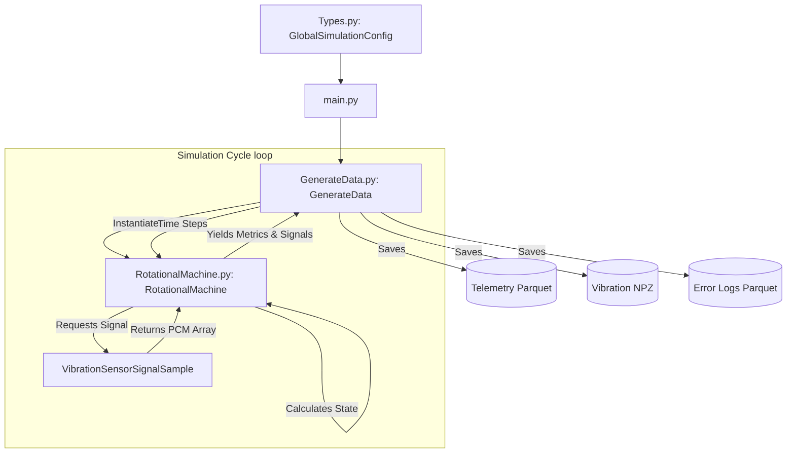

# Data Generation Architecture

## Overview
The `data-generation` project creates synthetic, realistic simulation data for rotational machines. It models physical boundaries, environmental factors, and equipment degradation to produce telemetry, vibration, and log data.

## Core Components
1. **`GlobalSimulationConfig` (`Types.py`)**: Defines global simulation parameters, including time ranges, machine counts, degradation rates, environmental cycles, and fault probabilities.
2. **`RotationalMachine` (`RotationalMachine.py`)**: Simulates a physical machine. It tracks state variables (speed, load, temperature, pressure, voltage) and computes wear based on operating conditions. Simulates faults like imbalance and bearing issues.
3. **`VibrationSensorSignalSample` (`VibrationSensorSignalSample.py`)**: Generates raw PCM vibration data based on machine speed, health index, and active faults. Injects realistic noise, harmonics, and shock pulses for faults.
4. **`GenerateData` (`GenerateData.py`)**: Orchestrates the simulation timeline. Manages machine lifecycles, runs operating cycles, aggregates data, and flushes outputs to Parquet (telemetry, logs) and NPZ (vibration) files.
5. **`main.py`**: The entry point that instantiates the configuration and triggers the generation process.

## Physical Boundaries and Relationships
- **Environmental Impact**: Ambient temperature follows a daily sine-wave cycle. Machine temperature is a function of ambient temperature plus internal friction generated by speed, load, and health.
- **Degradation/Wear**: Wear accumulates non-linearly. High stress (high speed, load, temperature) accelerates damage. As health drops below 85%, the probability of a fault activating increases logistically.
- **Fault Interrelationships**: 
  - *Bearing Fault*: Increases friction, causing further temperature spikes and characteristic high-frequency vibration shocks. Can cause voltage drops.
  - *Imbalance Fault*: Alters the vibration profile primarily at fundamental and first harmonic frequencies.
- **Operational Feedback**: High temperatures (over a strict threshold) or catastrophic wear (health <= 0) cause the machine to break down, triggering an event log and halting operation until "fixed."

## Data Flow Diagram

